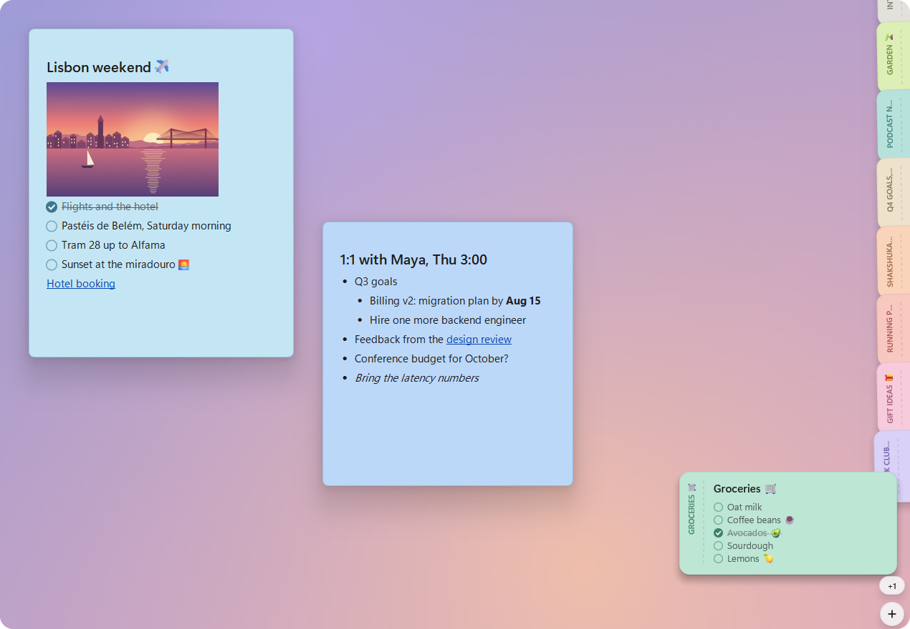
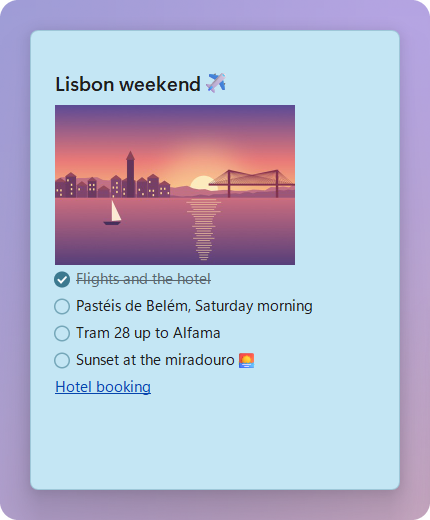
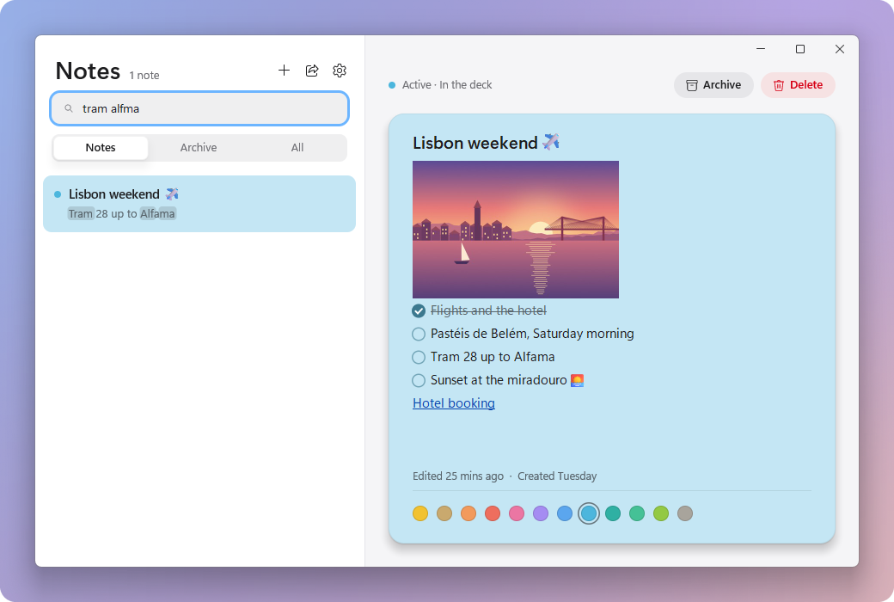
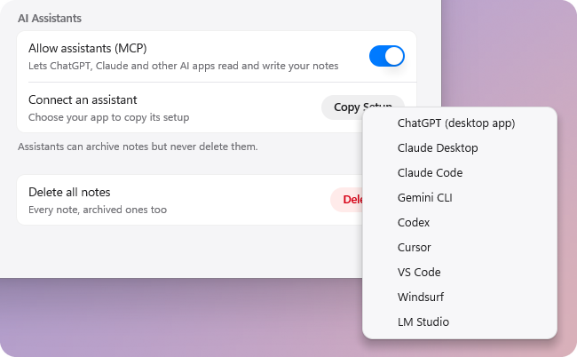
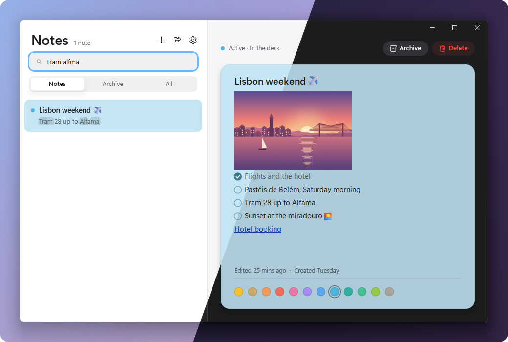

<h1 align="center">PeekABoo Notes</h1>

<p align="center">
  <b>Sticky notes that wait at the edge of your screen, and get out of your way.</b><br>
  For Windows 10 and 11. A 1 MB native app that idles at about 3 MB of memory and 0% CPU.
</p>

<p align="center">
  <picture>
    <source media="(prefers-color-scheme: dark)" srcset="docs/screenshots/hero-dark.png">
    
  </picture>
</p>

Your notes sit on the edge of the screen as a slim strip of colour. Point at it and they fan out as tabs; rest on one and it slides out to show you the note; click and it opens as a paper card, right where you left it. Click away and it flies home. Nothing to find, nothing to launch, nothing in your taskbar.

## Always one move away

- **The deck.** A pill of colour capsules on the screen edge that fans out into tabs as you point at it. Peek at any note without opening it.
- **Hotkeys from anywhere.** Ctrl+Alt+N writes a new note; Ctrl+Alt+A finds an old one.
- **Pin what matters.** A pinned note stays open and on top; everything else tucks itself away when you're done with it.
- **Exactly where you left it.** Each note reopens in the same spot, scrolled to the same line, caret where you stopped.

## Notes that feel like paper

- **Write, don't format.** Type `- `, `1. ` or `[] ` and you have a list or a checklist. Tab nests, Enter steps out. Bold, italic, underline and strikethrough are a keystroke away.
- **Quotes, code and tables.** Type `> ` for a quote or ```` ``` ```` for a code block, add a table from the right-click menu, and centre or right-align any line or picture. A quote can hold a list or a checklist, and sit under a list item. All of it exports as plain Markdown.
- **Undo that remembers.** Ctrl+Z goes back through what you typed, and on through the last twenty saved versions of the note: after closing and reopening it, or after an assistant changed it. Ctrl+Y comes forward again.
- **Checklists you'll enjoy ticking.** Circles fill with a little spring, and done items quietly strike through.
- **Links that just work.** Type an address and it's a link. Select words and press Ctrl+K to name one.
- **Pictures and files.** Drop them on a note: pictures show inline, files as a paperclip you can open or drag back out.
- **Colour emoji** ❤️ 🚀 and twelve paper colours, four typefaces and three text sizes.

<p align="center">
  <picture>
    <source media="(prefers-color-scheme: dark)" srcset="docs/screenshots/note-dark.png">
    
  </picture>
</p>

## Find anything

<p align="center">
  <picture>
    <source media="(prefers-color-scheme: dark)" srcset="docs/screenshots/all-notes-dark.png">
    
  </picture>
</p>

**All Notes** puts everything in one place, with search that forgives: words in any order, the start of a word, a typo or a missing accent. "relchk" finds your release checklist. Matches are marked, best first, and you can edit right there without opening a window. Archive instead of deleting, and every delete comes with Undo.

## Share it, take it anywhere

- **Share** the notes you pick as one zip, straight to Mail, Teams or Nearby Sharing.
- **Export** to plain Markdown, pictures and files included. It reads well in Notepad and looks right in VS Code or any Markdown viewer.
- **Import** Markdown or text files back, formatting and attachments included.

## Works with your AI assistant

Turn it on in Settings and **ChatGPT, Claude, Gemini, Copilot, Cursor** and other assistants can find, read and write your notes, through the open [Model Context Protocol](https://modelcontextprotocol.io). Pick your app, press **Connect**, restart the app. Assistants can create, edit and archive notes, but never delete them. It's off until you say so, and works only on this computer.

<p align="center">
  <picture>
    <source media="(prefers-color-scheme: dark)" srcset="docs/screenshots/assistants-dark.png">
    
  </picture>
</p>

## Made to feel at home

- **Light and dark**, following Windows or your choice.
- **Six languages**: English, German, Spanish, French, Hindi and Japanese.
- **Fluid motion**: everything moves on springs, and Reduce Motion calms it down.

<p align="center">
  
</p>

## Small, fast and private

- **Native** Rust on Win32: no web view, no runtime, no background service.
- **Tiny**: about 1 MB, about 3 MB of memory while it waits, and no CPU at all until you use it.
- **Fast with thousands of notes**: it starts in a fraction of a second.
- **Yours**: one readable file in your Documents folder, saved safely with a backup. No account, no network, no telemetry.
- **Portable** if you want it: notes can live beside the app on a USB stick.

## Install

Run the setup. It installs just for you, without admin rights, and can start with Windows. Uninstalling asks before it touches your notes.

To build it yourself, or to see how it works inside, read [DEVELOPER.md](DEVELOPER.md).

## License

Copyright (C) 2026 Ashwani Kumar. Free software under the [GNU GPL v3 or later](LICENSE).
