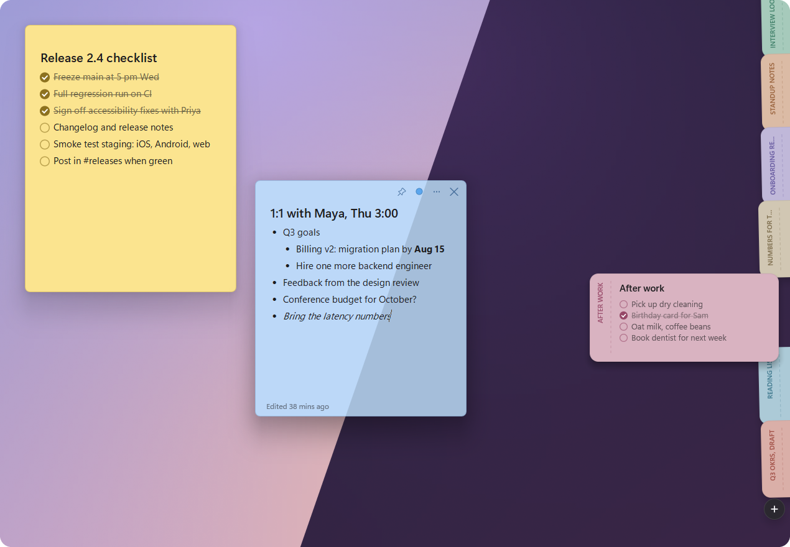

<h1 align="center">PeekABoo Notes</h1>

<p align="center">
  Sticky notes that live on the edge of your screen, for Windows 10 and 11.<br>
  A native Rust app under 1 MB that uses about 3 MB of memory while it waits.
</p>

<p align="center">
  
</p>

A slim pill sits on the screen edge, one colour capsule per note. Point at it and your notes fan out as tabs. Rest on a tab and the card slides out to preview the note; click and it opens as its own floating window. Everything moves on springs, follows the Windows light or dark appearance, and speaks your language.

## Features

**The edge deck**
- A pill of colour capsules that fans out into tabs. The tab under the pointer bulges, and resting on it slides the card out as a preview; a long note fades out at the bottom of its card. Long titles scroll along the tab.
- Drag tabs to reorder them. Show 5, 8 or 12 cards; a "+N" chip opens the rest.
- Right-click a card for its menu; the card stays out beside the menu.
- **Show in Deck** keeps any note active but off the edge.

**Notes**
- Borderless paper cards that reopen where you left them: same place on screen, same scroll, caret where you stopped. Click away and an open note flies back to the deck; pin it to keep it open and on top (Settings can keep every note open instead).
- Long notes get a slim scroll bar that shows while you scroll; drag it, click the track, or use the wheel anywhere on the note.
- Bold, italic, underline and strikethrough. The first line is the title.
- Links: addresses you type are clickable, and Ctrl+K (or pasting an address over selected text) turns any words into a link. Hovering one shows where it goes; export writes it as `[words](address)` and import reads it back.
- Bullets, numbers and checklists:
  - Typing `- `, `* `, `1. ` or `[] ` at the start of a line converts it; Backspace right after reverts.
  - Tab and Shift+Tab nest items; numbers go 1. → a. → i.
  - Enter on an empty item steps out a level, then ends the list.
  - Checklist circles fill and tick with a little spring. Done items are struck through, and Ctrl+Z right after a tick reverses it.
- Twelve paper colours, four typefaces (System, Serif, Mono, Hand) and three text sizes.

**All Notes**

<p align="center">
  
</p>

- Search that forgives: words in any order, word starts ("rel" finds "release"), letters in runs ("relchk"), small typos and accents. Best matches first, with the matches marked and a line from the body when that is where it matched.
- Switch between Notes, Archive and All.
- Multi-select, drag to reorder, and edit inline. The + here adds a note right in the list, ready to type.
- A note already open in its own window shows **Open Here** to bring it back.
- Archive instead of deleting. Delete comes with a 10-second Undo that waits while you point at it.

**Settings**

<p align="center">
  
</p>

- **General:** theme, language, Reduce Motion and start with Windows.
- **Notes:** typeface and size with a live preview, plus the new-note colour.
- **Deck:** screen edge, cards in the deck, where new notes go, and behaviour over full-screen apps.
- **Data:** where your notes are kept (and whether this copy is portable), import and export Markdown (each button answers with a ✓ and a count, or a ✗), and Delete All Notes, which asks first and can still be undone.

## Light and dark

Every window follows the Windows appearance, or you can pick one in Settings. The screenshots above show both halves of the same scene.

## Small and quiet

Native **Rust on raw Win32**: no web view, no runtime, no background service. Windows' own RichEdit does the editing and DirectWrite draws the text.

- About **1 MB** to download, a single exe.
- About **3 MB** of memory and **0% CPU** while it waits on the edge.
- Nothing runs while it waits: it only draws frames while something moves.

## Shortcuts

**Anywhere**

| Keys | Action |
|---|---|
| Ctrl+Alt+N | New note |
| Ctrl+Alt+A | All Notes |
| Ctrl+Alt+L | Archive |
| Ctrl+Alt+O | Reopen last note |
| Ctrl+Alt+H | Show or hide the deck |
| Ctrl+Alt+E | Move the deck to the other edge |

If another app already uses one of these, PeekABoo Notes goes without it.

**In a note**

| Keys | Action |
|---|---|
| Esc / Ctrl+W | Close |
| Ctrl+B / I / U | Bold / italic / underline |
| Ctrl+K | Link the selected text, or change the link at the caret (pasting an address over selected text links it too) |
| Ctrl+Shift+X | Strikethrough |
| Ctrl+Shift+8 / 7 | Bulleted / numbered list |
| Ctrl+Shift+L | Checklist |
| Ctrl+Enter | Tick or untick the checklist item |
| Tab / Shift+Tab | Indent / outdent a list item |
| Ctrl+. | Next colour |
| Ctrl+Shift+P | Keep on top |
| Ctrl+Shift+A | Archive |
| Ctrl+Shift+Del | Delete (with Undo) |
| Ctrl+[ / Ctrl+] | Previous / next note |
| Ctrl+N | New note |

Paste is always plain text, so notes keep a consistent look.

## Languages

English, German, Spanish, French, Hindi and Japanese are built in. By default PeekABoo Notes follows Windows' preferred display languages: the exact tag, then the base language, then English. Settings › General › Language overrides that. Dates and times are formatted by Windows for the chosen locale.

Interface text lives in Android-style resource files, one per language: `src/common/i18n/strings/strings.<tag>.xml`.

```xml
<resources>
    <string name="menu_new_note">New Note</string>
    <string name="window_all_notes">All Notes — %1$s</string>
    <plurals name="notes_count">
        <item quantity="one">%d note</item>
        <item quantity="other">%d notes</item>
    </plurals>
</resources>
```

- **Placeholders:** `%s` and `%d` in order, or `%1$s` and `%2$d` by position.
- **Plurals:** use the CLDR categories (zero, one, two, few, many, other).
- **Fallback:** English is the reference; any key a translation lacks falls back to it.

**Adding a language**
1. Copy `strings.en.xml` to `strings.<tag>.xml` (for example `strings.it.xml` or `strings.pt-BR.xml`) and translate the text.
2. Either add the file to `BUILTIN` in `src/common/i18n/mod.rs`, or drop it into a `lang` folder next to `peekaboo-notes.exe` (or in the notes folder).

Files in `lang` are read at startup and override the built-in strings, so you can try a translation without rebuilding. Every build copies the built-in files to `target\<profile>\lang\`. `cargo test` checks that every built-in language has exactly the keys and placeholders of English.

## Import and export

- **Export** writes one Markdown file per note into a folder you pick (the picker remembers it). It never overwrites a file; a name already in the folder gets "(2)".
- **Import** reads `.md` and `.txt` files and turns their Markdown into real formatting: headings, `**bold**`, `_italic_`, `~~strike~~`, bullets, numbers, `[ ]` / `[x]` checklists and nested lists.

A round trip keeps nesting, emphasis and ticked items intact.

## Your data

Notes are stored in one readable file, `Documents\PeekABoo Notes\notes.json`:
- each note keeps its RTF and a plain-text Markdown copy;
- writes are atomic (temp file, then rename);
- `notes.backup.json` holds the last good copy from the previous launch. If `notes.json` can't be read (locked by another program, or damaged), the app opens the backup instead and never writes over the original.

There is no network access and no telemetry.

`logs\peekaboo.log` in the same folder records what happened (start and exit, load and save errors, import and export counts), never what your notes say. It rotates at 512 KB, keeping one older file (`peekaboo.1.log`). If something goes wrong, attaching it to a bug report helps.

**Portable mode:** create an empty file named `portable` next to `peekaboo-notes.exe`. Notes then live in `PeekABooData\` beside the exe, so you can carry them on a USB stick.

## Build

```
cargo build --release
target\release\peekaboo-notes.exe
```

**Installers**
- **Setup wizard (Inno Setup):** `powershell -ExecutionPolicy Bypass -File packaging\inno\build-setup.ps1` builds `target\setup\PeekABooNotes-Setup-<version>.exe` (add `-NoBuild` to reuse `target\release`). It installs per user without admin, offers a desktop shortcut and starting with Windows, and its uninstaller asks whether to delete your notes too. Needs Inno Setup 6 (`winget install JRSoftware.InnoSetup`).
- **MSIX:** `powershell -ExecutionPolicy Bypass -File packaging\build-msix.ps1` builds a package in `target\msix\` (pass `-CertPath`/`-Password` or `-Thumbprint` to sign it). An installed copy starts with Windows through the package's startup task, and uninstalling it from Settings > Apps leaves your notes in Documents.

Needs Rust (edition 2024) and runs on Windows 10 or 11.
- `cargo test` runs the unit tests (string files, plural rules, the Markdown parser).

**Developer switches**
- `PEEKABOO_THEME=light|dark` forces an appearance.
- `PEEKABOO_PERF=1` logs frame times, and which parts asked for the frames, to `%TEMP%\peekaboo-perf.txt`.
- `PEEKABOO_TRACE=1` adds DEBUG lines (menu events and the like) to `logs\peekaboo.log`, and symbolized stacks to panic reports.
- `PEEKABOO_CRASH=panic|fault|overflow` crashes on purpose right after startup, to test crash reporting.

A crash writes a minidump to `logs\crash-YYYYMMDD-HHMMSS.dmp` (the newest three are kept), and its report, with raw `module+offset` stack addresses, to the log and to `crash.log` in the notes folder. Open the dump in Visual Studio or WinDbg next to the matching build's `.pdb`.

## Code map

The app is split so other platforms can be added beside Windows: `src/common/` is portable and never calls an operating system directly (a test enforces it), and each platform module (today `src/win/`) supplies the windows, text, editor and system services, plus the handful of functions in `crate::os` that `common` relies on (local time, the Documents folder, preferred languages, locale date formats, a system description).

| Path | Contents |
|---|---|
| `src/main.rs` | Entry point: picks the platform module |
| `src/common/` | The portable app, with no OS calls: the note store (`store.rs`), interface strings (`i18n/`), design tokens (`theme.rs`), springs (`anim.rs`), the log (`log.rs`) and small helpers (`util.rs`). What it needs from the OS comes through `crate::os` |
| `src/win/` | Windows: `os.rs` (what `common` asks of the OS), `app/` (message loop, note lifecycle, menus, import/export, autostart), `ui/` (deck, note windows, All Notes, Settings, menus, toasts, flying cards), `editor/` (RichEdit and the checklist overlay), `render/` (software canvas, DirectWrite, frame clock), `crash.rs`, `theme.rs`, `util.rs` |

## License

Copyright (C) 2026 Ashwani Kumar

PeekABoo Notes is free software: you can redistribute it and/or modify it under the terms of the GNU General Public License as published by the Free Software Foundation, either version 3 of the License, or (at your option) any later version. It is distributed in the hope that it will be useful, but without any warranty; see the [LICENSE](LICENSE) file for the full text.

Every source file carries the same notice as `SPDX-License-Identifier: GPL-3.0-or-later`.
