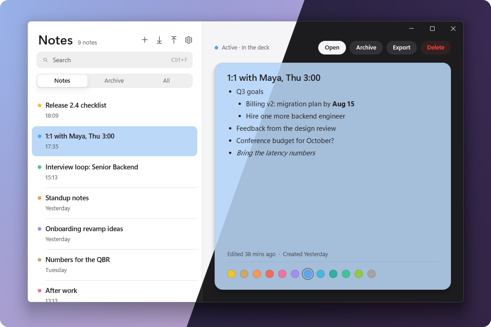
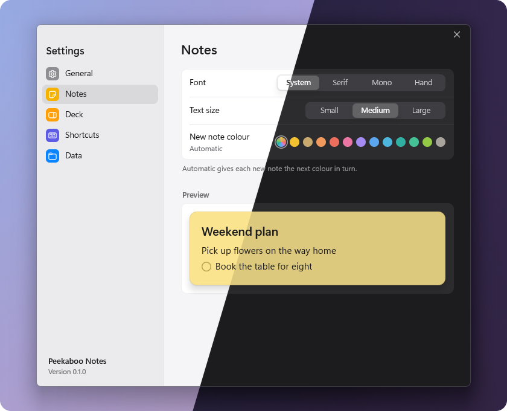

<h1 align="center">Peekaboo Notes</h1>

<p align="center">
  Sticky notes that live on the edge of your screen, for Windows 10 and 11.<br>
  A native Rust app under 1 MB that uses about 3 MB of memory while it waits.
</p>

<p align="center">
  
</p>

A slim pill sits on the screen edge, one colour capsule per note. Point at it and your notes fan out as tabs. Rest on a tab and the card slides out to preview the note; click and it opens as its own floating window. Everything moves on springs, follows the Windows light or dark appearance, and speaks your language.

## Features

**The edge deck**
- A pill of colour capsules that fans out into tabs. The tab under the pointer bulges, and resting on it slides the card out as a preview. Long titles scroll along the tab.
- Drag tabs to reorder them. Show 5, 8 or 12 cards; a "+N" chip opens the rest.
- Right-click a card for its menu; the card stays out beside the menu.
- **Show in Deck** keeps any note active but off the edge.

**Notes**
- Borderless paper cards that reopen where you left them, with the caret at the end, ready to carry on. Pin one to keep it on top.
- Bold, italic, underline and strikethrough. The first line is the title, and links are clickable.
- Bullets, numbers and checklists:
  - Typing `- `, `* `, `1. ` or `[] ` at the start of a line converts it; Backspace right after reverts.
  - Tab and Shift+Tab nest items; numbers go 1. → a. → i.
  - Enter on an empty item steps out a level, then ends the list.
  - Checklist circles fill and tick with a little spring. Done items are struck through, and Ctrl+Z right after a tick reverses it.
- Twelve paper colours, four typefaces (System, Serif, Mono, Hand) and three text sizes.

**All Notes**

<p align="center">
  
</p>

- Search, and switch between Notes, Archive and All.
- Multi-select, drag to reorder, and edit inline.
- A note already open in its own window shows **Open Here** to bring it back.
- Archive instead of deleting. Delete comes with a 10-second Undo that waits while you point at it.

**Settings**

<p align="center">
  
</p>

- **General:** theme, language, Reduce Motion and start with Windows.
- **Notes:** typeface and size with a live preview, plus the new-note colour.
- **Deck:** screen edge, cards in the deck, where new notes go, and behaviour over full-screen apps.
- **Data:** import and export Markdown. Each button answers with a ✓ and a count, or a ✗ if it failed.

## Light and dark

Every window follows the Windows appearance, or you can pick one in Settings. The screenshots above show both halves of the same scene.

## Small and quiet

Native **Rust on raw Win32**: no web view, no runtime, no background service. Windows' own RichEdit does the editing and DirectWrite draws the text.

| | |
|---|---|
| Download | **0.95 MB**, a single exe |
| Waiting on the edge | **2.8 MB** private memory, **16.5 MB** working set, **0.00% CPU** |
| All Notes and a note open | 21 MB private, 42 MB working set, 0% CPU when idle |
| Back to just the deck | 10 MB private, **12 MB** working set (memory is handed back to Windows 3 s after the last window closes) |
| While the deck animates | about a quarter of one core (1.2% of the whole CPU), 1–5 ms per frame, only while something moves |

Measured on an Intel Core i5-14500 with Windows 11, a 2560×1080 display at 100% scale, and nine notes. Memory figures are from Task Manager's counters (private bytes and working set), and CPU was sampled over 15–30 seconds.

Nothing runs while the app waits:
- The frame clock runs only while something moves, paced by the compositor.
- Hover comes from the windows' own mouse messages.
- Full-screen detection uses the shell's app-bar notification instead of polling.

For comparison, typical idle memory for the same kind of app on other stacks:

| Stack | Typical idle memory |
|---|---|
| Electron | 100–200 MB |
| Tauri / WebView2 | 40–80 MB, across several processes |
| WPF / WinUI 3 | 30–60 MB |
| **Rust + Win32 (Peekaboo Notes)** | **~3 MB private, ~16 MB working set** |

## Shortcuts

**Anywhere**

| Keys | Action |
|---|---|
| Ctrl+Alt+N | New note |
| Ctrl+Alt+A | All Notes |
| Ctrl+Alt+L | Archive |
| Ctrl+Alt+O | Reopen last note |
| Ctrl+Alt+H | Show or hide the deck |
| Ctrl+Alt+E | Move the deck to the other edge |

If another app already uses one of these, Peekaboo Notes goes without it.

**In a note**

| Keys | Action |
|---|---|
| Esc / Ctrl+W | Close |
| Ctrl+B / I / U | Bold / italic / underline |
| Ctrl+Shift+X | Strikethrough |
| Ctrl+Shift+8 / 7 | Bulleted / numbered list |
| Ctrl+Shift+L | Checklist |
| Ctrl+Enter | Tick or untick the checklist item |
| Tab / Shift+Tab | Indent / outdent a list item |
| Ctrl+. | Next colour |
| Ctrl+Shift+P | Keep on top |
| Ctrl+Shift+A | Archive |
| Ctrl+Shift+Del | Delete (with Undo) |
| Ctrl+[ / Ctrl+] | Previous / next note |
| Ctrl+N | New note |

Paste is always plain text, so notes keep a consistent look.

## Languages

English, German, Spanish, French, Hindi and Japanese are built in. By default Peekaboo Notes follows Windows' preferred display languages: the exact tag, then the base language, then English. Settings › General › Language overrides that. Dates and times are formatted by Windows for the chosen locale.

Interface text lives in Android-style resource files, one per language: `src/i18n/strings/strings.<tag>.xml`.

```xml
<resources>
    <string name="menu_new_note">New Note</string>
    <string name="window_all_notes">All Notes — %1$s</string>
    <plurals name="notes_count">
        <item quantity="one">%d note</item>
        <item quantity="other">%d notes</item>
    </plurals>
</resources>
```

- **Placeholders:** `%s` and `%d` in order, or `%1$s` and `%2$d` by position.
- **Plurals:** use the CLDR categories (zero, one, two, few, many, other).
- **Fallback:** English is the reference; any key a translation lacks falls back to it.

**Adding a language**
1. Copy `strings.en.xml` to `strings.<tag>.xml` (for example `strings.it.xml` or `strings.pt-BR.xml`) and translate the text.
2. Either add the file to `BUILTIN` in `src/i18n/mod.rs`, or drop it into a `lang` folder next to `peekaboo-notes.exe` (or in the notes folder).

Files in `lang` are read at startup and override the built-in strings, so you can try a translation without rebuilding. Every build copies the built-in files to `target\<profile>\lang\`. `cargo test` checks that every built-in language has exactly the keys and placeholders of English.

## Import and export

- **Export** writes one Markdown file per note into a folder you pick (the picker remembers it). It never overwrites a file; a name already in the folder gets "(2)".
- **Import** reads `.md` and `.txt` files and turns their Markdown into real formatting: headings, `**bold**`, `_italic_`, `~~strike~~`, bullets, numbers, `[ ]` / `[x]` checklists and nested lists.

A round trip keeps nesting, emphasis and ticked items intact.

## Your data

Notes are stored in one readable file, `Documents\Peekaboo Notes\notes.json`:
- each note keeps its RTF and a plain-text Markdown copy;
- writes are atomic (temp file, then rename);
- `notes.backup.json` holds the last good copy from the previous launch. If `notes.json` can't be read (locked by another program, or damaged), the app opens the backup instead and never writes over the original.

There is no network access and no telemetry.

`logs\peekaboo.log` in the same folder records what happened (start and exit, load and save errors, import and export counts), never what your notes say. It rotates at 512 KB, keeping one older file (`peekaboo.1.log`). If something goes wrong, attaching it to a bug report helps.

**Portable mode:** create an empty file named `portable` next to `peekaboo-notes.exe`. Notes then live in `PeekabooData\` beside the exe, so you can carry them on a USB stick.

## Build

```
cargo build --release
target\release\peekaboo-notes.exe
```

Needs Rust (edition 2024) and runs on Windows 10 or 11.
- `cargo test` runs the unit tests (string files, plural rules, the Markdown parser).

**Developer switches**
- `PEEKABOO_THEME=light|dark` forces an appearance.
- `PEEKABOO_PERF=1` logs frame times, and which parts asked for the frames, to `%TEMP%\peekaboo-perf.txt`.
- `PEEKABOO_TRACE=1` adds DEBUG lines (menu events and the like) to `logs\peekaboo.log`, and symbolized stacks to panic reports.
- `PEEKABOO_CRASH=panic|fault|overflow` crashes on purpose right after startup, to test crash reporting.

A crash writes a minidump to `logs\crash-YYYYMMDD-HHMMSS.dmp` (the newest three are kept), and its report, with raw `module+offset` stack addresses, to the log and to `crash.log` in the notes folder. Open the dump in Visual Studio or WinDbg next to the matching build's `.pdb`.

## Code map

| Path | Contents |
|---|---|
| `src/main.rs` | Entry point and module list |
| `src/app/` | App state and message loop (`mod.rs`), note lifecycle (`notes.rs`), menus and commands (`menus.rs`), import/export and autostart (`files.rs`), applying settings (`prefs.rs`) |
| `src/ui/deck/` | The edge deck: state and input (`mod.rs`), geometry and motion (`layout.rs`), painting (`draw.rs`) |
| `src/ui/note/` | Note windows: lifecycle (`mod.rs`), header and footer (`chrome.rs`), commands and key map (`commands.rs`), lists while typing (`lists.rs`), the editor subclass (`input.rs`) |
| `src/ui/allnotes/` | All Notes: state and input (`mod.rs`), rows and drag-reorder (`list.rs`), geometry (`layout.rs`), painting (`draw.rs`), the inline editor (`editor.rs`) |
| `src/ui/settings/` | Settings: state and input (`mod.rs`), page contents (`pages.rs`), geometry (`layout.rs`), painting (`draw.rs`) |
| `src/ui/` | Also `menu.rs` (popover menus), `toast.rs` (Undo), `ghost.rs` (cards flying between the deck and windows), and note previews (`mod.rs`) |
| `src/editor/` | RichEdit wrapper (`rich/`: FFI, `format.rs`, `lists.rs`, `markdown.rs`) and the checklist overlay (`checks.rs`) |
| `src/render/` | Software canvas (`gfx.rs`), DirectWrite text (`dw.rs`), springs and the frame clock (`anim.rs`) |
| `src/i18n/` | String resources (`mod.rs`, `xml.rs`), locale-aware times (`time.rs`), the language files (`strings/`) |
| `src/platform/` | Crash reports and dumps (`crash.rs`), the app log (`log.rs`), paths and small helpers (`util.rs`) |
| `src/store.rs`, `src/theme.rs` | The JSON note store; colours, materials and motion presets |
